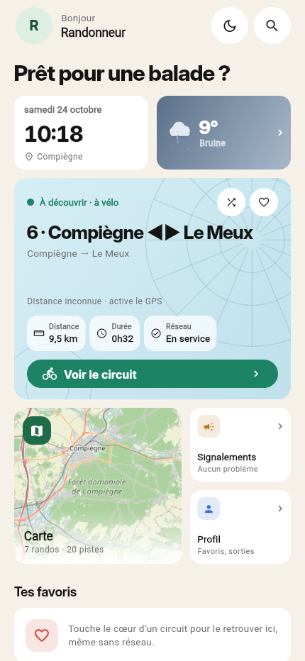
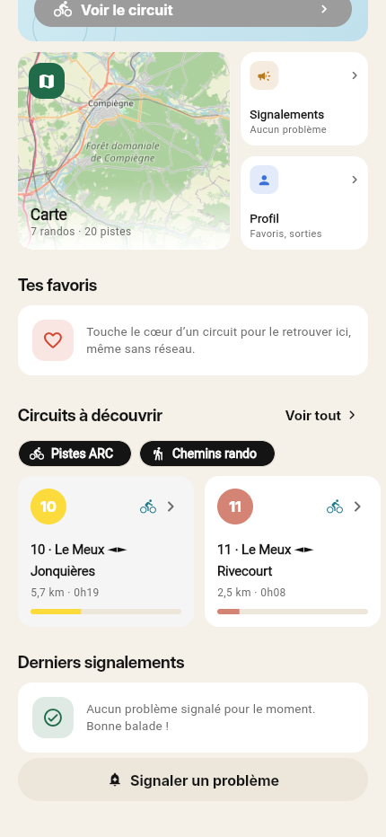
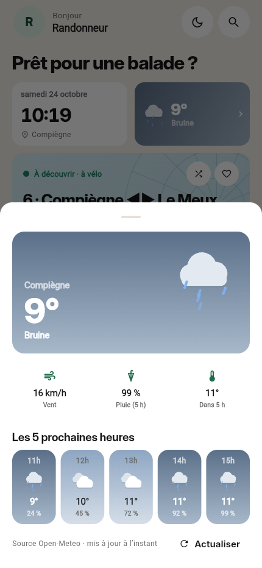
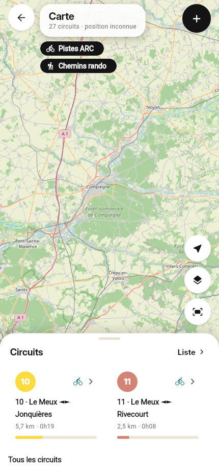

# Rando Oise

Application de randonnée **à pied et à vélo** pour l'Oise (intégration de Cyclo ARC), en deux parties :

| Dossier | Rôle |
|---|---|
| `apps/rando_user` | Application mobile Flutter (Android / iOS, web possible) pour les randonneurs |
| `apps/rando_admin` | Application web Flutter d'administration (ARC), authentification e‑mail / mot de passe |
| `packages/rando_core` | Package partagé : modèles, conversion Lambert‑93 → WGS84, importeur de sources, accès Firestore, thème |
| `tools/` | Scripts Node : import d'une source de randonnées, création d'un compte admin |
| `firestore.rules` | Règles de sécurité Firestore |
| `data/` | Sources de randonnées (zip au schéma national « itinéraires de randonnée ») |
| `apps/rando_user/assets/velo/` | Réseau cyclable de l'ARC (dataset Cyclo ARC : `itineraries_min.jsonl` + `geoms.wkb`) embarqué dans l'app, et `plan_arc.json` : correspondance avec le « Plan des itinéraires cyclables de l'ARC 2026 » (`data/carte/`) — numéros, noms, couleurs |

Backend : Firebase (projet `rando-oise-a4efa`) — Firestore, Authentication, Hosting.

## Fonctionnalités

**App utilisateur**
- Deux activités mélangées dans la même interface : randonnées à pied (sources Firestore) et pistes cyclables (dataset embarqué sur le téléphone, toujours disponible hors ligne). Filtre « Pistes ARC » / « Chemins rando » partout.
- Les pistes cyclables reprennent uniquement la numérotation, les noms et les couleurs du plan officiel de l'ARC (21 itinéraires ; les tronçons hors plan sont dessinés en gris fin et jamais listés). La correspondance plan ↔ tronçons du jeu de données est dans `assets/velo/plan_arc.json`.
- Carte MapLibre GL (composant repris de Cyclo ARC) : tracés, pastilles de départ, signalements et éléments, étiquettes.
- Suivi GPS repris de Cyclo ARC : caméra libre / suivi nord en haut / 3D dans le sens de marche, trace en direct, distance au tracé, progression, pause, et à l'arrivée le choix d'enregistrer ou non la sortie (historique local « Mes sorties »).
- Tuiles date/heure et météo (Open‑Meteo, Compiègne, icônes animées ; en la touchant, les 5 prochaines heures).
- Signalements et éléments remarquables : informations communautaires (catégorie + position, sans description), partagées entre randonneurs et cyclistes ; validation par le modérateur dans l'app admin.
- Tuile « À découvrir » tirée au hasard (pied ou vélo, fond différent), bouton pour en tirer une autre.
- Liste des itinéraires en mode liste ou carte, triés depuis une origine (position GPS, point choisi sur la carte, ou par nom), recherche et filtre par source.
- Fiche itinéraire : distance, durée, dénivelé, difficulté, présentation, pas à pas, infos pratiques, signalements et éléments remarquables du circuit.
- Suivi GPS : carte plein écran, position, tracé, distance au tracé, progression, distance parcourue, durée ; affichage optionnel des signalements / éléments.
- Favoris (stockés sur l'appareil).
- Signalement : catégorie (liste déroulante) et position GPS ou choisie sur la carte, sans description. Chaque appareil (connexion anonyme) peut faire « +1 » une seule fois sur un signalement, jamais sur le sien. Sur la carte, l'auteur n'est pas visible ; chaque utilisateur retrouve ses propres signalements et éléments dans son profil. Le statut (Signalé / En cours / Validé) est visible ; l'admin peut supprimer.
- Éléments remarquables : proposition par les randonneurs, visibles par tous une fois validés par l'admin.
- Hors ligne : persistance Firestore (itinéraires, signalements, éléments), tuiles de carte mises en cache, téléchargement de la carte d'un circuit (zooms 12‑16), écritures mises en file d'attente jusqu'au retour du réseau.

**App admin (web)**
- Connexion par login / mot de passe ; seuls les comptes présents dans la collection `admins` ont accès.
- Liste et fiche des itinéraires, carte globale.
- Signalements : filtres par statut, changement de statut (Signalé / En cours / Validé), commentaire, suppression.
- Éléments remarquables : validation / refus / suppression.
- Sources : import d'un zip ou json, activation / désactivation, suppression.

## Modèle de données (Firestore)

| Collection | Contenu |
|---|---|
| `sources/{id}` | name, producteur, itineraireCount, enabled, bounds, importedAt |
| `itineraires/{uuid}` | sourceId, nom, tracks (polylignes encodées `lat,lng;…`), start, bounds, longueurM, dureeH, difficulte, denivele…, presentation, instructions, parking, transports… |
| `signalements/{id}` | itineraireId, categorie, description, position, statut (`signale` / `en_cours` / `valide`), auteurId, votes, voters[], commentaireAdmin |
| `elements/{id}` | itineraireId, categorie, titre, description, position, statut (`en_attente` / `valide` / `refuse`), auteurId |
| `admins/{uid}` | email, role |

Les règles (`firestore.rules`) autorisent la lecture publique, la création de signalements / éléments par un utilisateur authentifié (anonyme), un seul « +1 » par utilisateur, et réservent le reste aux admins.

## Mise en route

### Prérequis
- Flutter 3.41+, Node 20+, Firebase CLI (`npm i -g firebase-tools`), `dart pub global activate flutterfire_cli`.
- Clé de compte de service Firebase dans `secret/` (jamais commitée).

### Console Firebase (à faire une fois)
1. **Authentication → Commencer** : activer les fournisseurs **Anonyme** (app utilisateur) et **E‑mail / mot de passe** (admin).
   Tant que ce n'est pas fait, l'app affiche « Le service de signalement n’est pas encore activé » et `tools/create_admin.js` s'arrête avec le code 2.
   Ni la CLI ni le compte de service ne peuvent l'activer (API Identity Toolkit).
2. Firestore est déjà créé (`europe-west1`) et les règles sont déployées avec `firebase deploy --only firestore:rules`.
3. Hosting : l'admin est en ligne sur https://rando-oise-a4efa.web.app (voir `/admin`).

### Importer une source de randonnées
```bash
cd tools && npm install && cd ..
node tools/import_source.js "data/itinerairerandonnee_CC_des_Lisières_de_l'Oise.zip"
# --dry-run pour vérifier sans écrire
```
L'admin web permet aussi d'importer un zip/json directement (onglet Sources).

### Importer les pistes cyclables dans Firestore (pour l'admin)

```bash
node tools/import_cyclo.js            # lit apps/rando_user/assets/velo, écrit la source arc-velo
```
L'app mobile n'utilise pas cette copie : elle lit le dataset embarqué.

### Créer un compte administrateur
```bash
node tools/create_admin.js admin admin        # compte initial : identifiant admin / mot de passe admin
node tools/create_admin.js admin@exemple.fr "MotDePasseSolide"
```
Le formulaire de connexion de l'admin demande un **identifiant** et un **mot de passe**. Un identifiant sans `@`
devient `<identifiant>@rando-oise.app` et un mot de passe de moins de 6 caractères est complété par `#`
(`admin` / `admin` → `admin@rando-oise.app` / `admin#`), le même mapping étant appliqué par le script.
Le compte n'a de droits que s'il possède un document `admins/{uid}`, créé par le script.

### Lancer les applications
```bash
# App utilisateur (téléphone / émulateur Android)
cd apps/rando_user && flutter run

# App admin (Chrome)
cd apps/rando_admin && flutter run -d chrome
```

### Déployer l'admin sur Firebase Hosting
```bash
cd apps/rando_admin && flutter build web --release && cd ../..
firebase deploy --only hosting:admin
```

### Tests
```bash
cd packages/rando_core && flutter test          # modèles, import, dataset vélo
cd apps/rando_user && flutter test              # logique hors ligne, messages d'authentification
cd apps/rando_user && flutter test integration_test/offline_region_test.dart -d <device>   # téléchargement d'une carte hors ligne sur l'appareil
cd tools && npm run test:e2e                    # règles Firestore sur les émulateurs (ajout, +1, refus, suppression admin, anonymat)
cd tools && npm run test:e2e:live               # idem contre le projet réel (Authentication activée requise)
```
Les tests de bout en bout (`tools/test_e2e.js`, 43 vérifications) rejouent le parcours réel : un appareil anonyme crée un
signalement, un second le voit et fait +1 (une seule fois, jamais sur le sien), personne ne peut le modifier ou le supprimer
sauf l'admin, les éléments remarquables passent par `en_attente` → `valide`, et le document ne porte jamais d'e‑mail ni
de nom (les règles n'acceptent que la liste exacte des champs). Détails dans `tools/README.md`.

## Fond de carte et hors ligne
L'app utilisateur (MapLibre GL) propose OpenStreetMap et le Plan IGN (Géoplateforme, sans clé) ; le choix est dans Profil. Les tuiles vues sont mises en cache par MapLibre, et chaque fiche propose « Enregistrer la carte hors ligne » (région hors ligne MapLibre, zooms 12‑16). Les pistes cyclables sont intégrées à l'app ; les randonnées consultées sont conservées par la persistance Firestore.

## Aperçu de l'app utilisateur

| Accueil | Accueil (suite) | Météo | Carte |
|---|---|---|---|
|  |  |  |  |

Captures réalisées sur la version web (Chrome headless, 430 × 932). Police Inter (licence OFL, incluse dans `packages/rando_core/fonts`).
